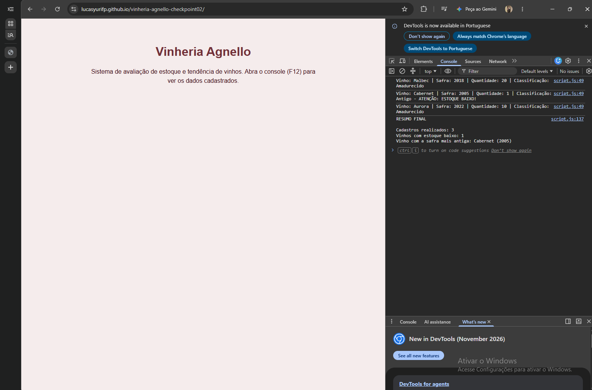

# Vinheria Agnello - Checkpoint 02

Sistema de avaliação de estoque e tendência de vinhos, feito em JavaScript.

# O que foi implementado

- Cadastro de vários vinhos em sequência usando `prompt()` e `alert()`, perguntando ao final de cada um se deseja cadastrar outro
- Função para validar as entradas (safra e quantidade)
- Função para verificar se o estoque está baixo (menos de 5 unidades)
- Função para classificar o vinho em jovem, amadurecido ou antigo
- Função para mostrar os dados no console e avisar por `alert()`
- Resumo final com o total de cadastros, quantos vinhos têm estoque baixo e o vinho com a safra mais antiga
- Uso de funções, escopo local de variáveis e laços de repetição (`while`), sem arrays nem objetos

# Integrante

- Lucas Yuri Fernandes Pinto / RM 575316

# Link do GitHub Pages

https://lucasyurifp.github.io/vinheria-agnello-checkpoint02/